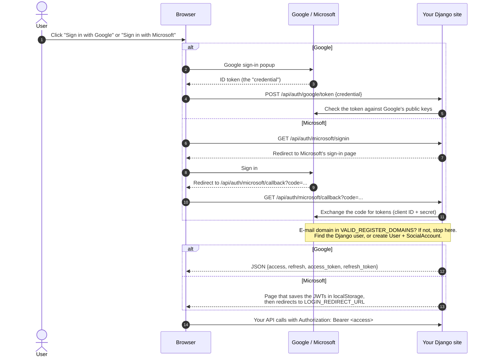
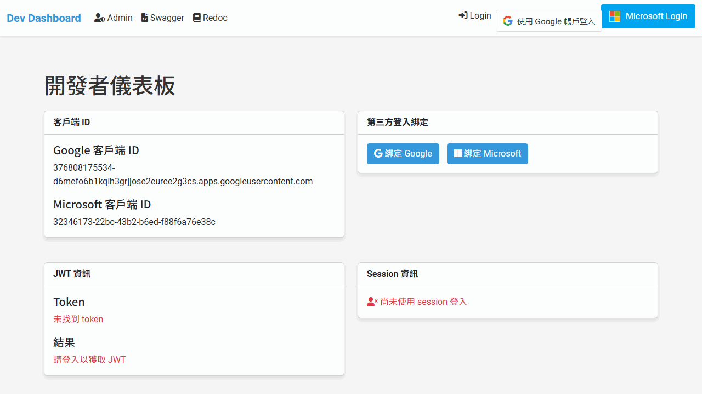

# Django Simple 3rd Party JWT

[](https://github.com/NatLee/django-simple-3rd-party-jwt/actions/workflows/test.yml)
[](https://pypi.org/project/django-simple-third-party-jwt/)
[](https://pypi.org/project/django-simple-third-party-jwt/)
[](https://pypi.org/project/django-simple-third-party-jwt/)
[](https://github.com/NatLee/django-simple-3rd-party-jwt/blob/main/LICENSE)

Let people sign in to your Django site with **Google** or **Microsoft** and hand your
frontend a **JWT** it can send to your API. Add one app and a few settings and you get
login endpoints that check the provider's answer, keep only the e-mail domains you
allow, create the Django user on first login and answer with a
[Simple JWT](https://github.com/jazzband/djangorestframework-simplejwt) access/refresh pair.
No passwords to store, no OAuth plumbing to write.

- **Google**: your page shows Google's sign-in button, then POSTs the credential to `/api/auth/google/token`.
- **Microsoft**: a link to `/api/auth/microsoft/signin`; the user comes back with the tokens in `localStorage`.
- **Your API**: accepts `Authorization: Bearer <access token>` like any Simple JWT project.

## How it works



Each Google or Microsoft account is linked to a Django user through a small
`SocialAccount` table (`social_account` in the database, also in the Django admin),
so a returning user gets the same account.

## Install

```bash
pip install django-simple-third-party-jwt
```

This also installs Django REST framework, Simple JWT, `google-auth` and `msal`
(Microsoft's auth library). See [supported versions](#supported-versions).

## Quick start

### 1. Settings

In `settings.py`:

```python
import os

INSTALLED_APPS = [
    # ... Django's defaults, including "django.contrib.sessions"
    "rest_framework",
    "django_simple_third_party_jwt",
]

# The login routes live under /<JWT_3RD_PREFIX>/auth/... (required).
JWT_3RD_PREFIX = "api"

# Only these e-mail domains can sign in.
VALID_REGISTER_DOMAINS = ["gmail.com", "outlook.com", "hotmail.com", "live.com"]

# Credentials: see "Getting credentials" below. Keep the secret out of your code.
SOCIAL_GOOGLE_CLIENT_ID = "<your-client-id>.apps.googleusercontent.com"
SOCIAL_MICROSOFT_CLIENT_ID = "<your-application-client-id>"
SOCIAL_MICROSOFT_CLIENT_SECRET = os.environ["SOCIAL_MICROSOFT_CLIENT_SECRET"]

# Where the browser goes after a Microsoft login.
LOGIN_REDIRECT_URL = "/"

# Google Sign-In: let its popup talk back to your page, and send the referrer
# when testing on http://localhost (see Google's setup guide, linked below).
SECURE_CROSS_ORIGIN_OPENER_POLICY = "same-origin-allow-popups"
SECURE_REFERRER_POLICY = "no-referrer-when-downgrade"

# Let your own API views accept the JWT.
REST_FRAMEWORK = {
    "DEFAULT_AUTHENTICATION_CLASSES": [
        "rest_framework_simplejwt.authentication.JWTAuthentication",
        "rest_framework.authentication.SessionAuthentication",
    ],
}
```

Only using one provider? Leave the other one's settings out and don't link to its routes.
The app then logs a start-up warning about that provider's demo credentials, which you can ignore.

### 2. URLs

In your project's `urls.py`, include the app **at the root**. The `api/` part comes
from `JWT_3RD_PREFIX`, so don't put it in `path()` as well (that gives `/api/api/auth/...`).
The Simple JWT views let the frontend refresh and check tokens.

```python
from django.urls import include, path
from rest_framework_simplejwt.views import TokenObtainPairView, TokenRefreshView, TokenVerifyView

urlpatterns = [
    # ...
    path("", include("django_simple_third_party_jwt.urls")),
    path("api/auth/token", TokenObtainPairView.as_view(), name="token_get"),  # optional: username/password login
    path("api/auth/token/refresh", TokenRefreshView.as_view(), name="token_refresh"),
    path("api/auth/token/verify", TokenVerifyView.as_view(), name="token_verify"),
]
```

### 3. Migrate and run

```bash
python manage.py migrate
python manage.py runserver
```

Run the full `migrate`: the app's own table *and* Django's session table are needed.

You now have these routes:

| Route | Name | What it does |
|---|---|---|
| `POST /api/auth/google/token` | `google-token` | Google credential in, JWT pair out |
| `POST /api/auth/google/token/session` | `google-token-session` | Same, and also logs the user into the Django session |
| `GET /api/auth/microsoft/signin` | `microsoft-signin` | Sends the browser to Microsoft's sign-in page |
| `GET /api/auth/microsoft/callback` | `microsoft-callback` | Microsoft sends the browser back here; logs in and hands over the JWTs |
| `GET /api/auth/microsoft/signout` | `microsoft-signout` | Forgets the Microsoft token cache, then goes to sign-in |

### 4. Frontend

A plain HTML page is enough. Google's script turns the `g_id_onload` div into a
sign-in button and calls your function with the credential:

```html
<script src="https://accounts.google.com/gsi/client" async></script>

<div id="g_id_onload"
     data-client_id="<your-client-id>.apps.googleusercontent.com"
     data-callback="onGoogleCredential"></div>
<div class="g_id_signin" data-type="standard"></div>

<a href="/api/auth/microsoft/signin">Sign in with Microsoft</a>

<script>
  async function onGoogleCredential({ credential }) {
    const response = await fetch("/api/auth/google/token", {  // or .../token/session
      method: "POST",
      headers: { "Content-Type": "application/json" },
      body: JSON.stringify({ credential }),
    });
    if (!response.ok) {
      console.error("Login refused:", response.status, await response.json());
      return;
    }
    const { access, refresh } = await response.json();
    // The same keys the Microsoft callback page uses by default.
    localStorage.setItem("access_token", access);
    localStorage.setItem("refresh_token", refresh);
  }

  // Later, call your API with the token:
  function callApi(url) {
    return fetch(url, {
      headers: { Authorization: `Bearer ${localStorage.getItem("access_token")}` },
    });
  }
</script>
```

The login endpoints need no CSRF token. In a Django template you can render the client
ID from `settings.SOCIAL_GOOGLE_CLIENT_ID` instead of typing it twice.

What the Google endpoint answers:

| Situation | Status | Body |
|---|---|---|
| Signed in | `200` | `{"access": "...", "refresh": "...", "access_token": "...", "refresh_token": "..."}` (two names for the same pair) |
| No `credential` in the request | `400` | `{"credential": ["This field is required."]}` |
| E-mail domain not in `VALID_REGISTER_DOMAINS` | `401` | `{"status": "error", "detail": "This email is invalid."}` |
| Google does not accept the credential | `500` | `{"status": "error", "detail": "Something went wrong :("}` |

After a Microsoft login, the callback page shows a short "Welcome!" and redirects to
`LOGIN_REDIRECT_URL` after a few seconds, with the tokens already in `localStorage`.
The user is also logged into the Django session.
If the domain is not allowed, it says so in red and stores nothing.

## Settings reference

| Setting | Required | Default | What it does |
|---|---|---|---|
| `JWT_3RD_PREFIX` | **Yes** | none: start-up error | URL prefix for every route: `/<prefix>/auth/...`. No leading or trailing slash, e.g. `"api"`. Also part of the Microsoft redirect URI. |
| `SOCIAL_GOOGLE_CLIENT_ID` | For Google | a shared demo client, with a warning | Your Google OAuth client ID. |
| `SOCIAL_MICROSOFT_CLIENT_ID` | For Microsoft | a shared demo app, with a warning | The *Application (client) ID* of your Azure app. |
| `SOCIAL_MICROSOFT_CLIENT_SECRET` | For Microsoft | a shared demo app, with a warning | A client secret *value* of that app. Load it from the environment. |
| `VALID_REGISTER_DOMAINS` | No | `["gmail.com", "outlook.com", "hotmail.com", "live.com"]` | Only addresses on these domains can sign in, new and returning users alike. Google: the token's `email`. Microsoft: `preferred_username`. |
| `LOGIN_REDIRECT_URL` | No | Django's default, `/accounts/profile/` | Where the Microsoft callback page sends the browser. |
| `MICROSOFT_JWT_REDIRECT_ACCESS_TOKEN_KEY` | No | `"access_token"` | `localStorage` key the Microsoft callback page stores the access token under. |
| `MICROSOFT_JWT_REDIRECT_REFRESH_TOKEN_KEY` | No | `"refresh_token"` | Same, for the refresh token. |

Good to know:

- The app reads these settings once, at start-up. Changing them at runtime (for example
  with `override_settings` in your tests) does not reach it.
- Don't ship with the demo credentials. They belong to the package author, are public,
  and are meant for trying things out locally. The app logs a warning at start-up while
  you use them.
- Token lifetimes and signing are Simple JWT's job: set them in
  [`SIMPLE_JWT`](https://django-rest-framework-simplejwt.readthedocs.io/en/latest/settings.html).
- Frontend on another origin? Add [django-cors-headers](https://github.com/adamchainz/django-cors-headers).
- Behind a reverse proxy, make sure `request.build_absolute_uri()` sees the public scheme
  and host (`SECURE_PROXY_SSL_HEADER`, `USE_X_FORWARDED_HOST`). The Microsoft redirect URI
  is built from it.
- The app links accounts to Django's built-in `User` model.

## Getting credentials

<details>
<summary><b>Google: client ID</b></summary>

1. Open [Google Cloud console → APIs & Services → Credentials](https://console.cloud.google.com/apis/credentials)
   and pick or create a project. If asked, set up the OAuth consent screen first.
2. **Create credentials → OAuth client ID**, application type **Web application**.
3. Under **Authorized JavaScript origins** add every origin that shows the button.
   For local work add both `http://localhost` and `http://localhost:8000`.
4. Create it and copy the **Client ID** (`....apps.googleusercontent.com`) into
   `SOCIAL_GOOGLE_CLIENT_ID`. The client secret is not needed.

More in Google's guide: [Get your Google API client ID](https://developers.google.com/identity/gsi/web/guides/get-google-api-clientid).

</details>

<details>
<summary><b>Microsoft: client ID and secret</b></summary>

1. Open [Azure portal → Microsoft Entra ID → App registrations](https://portal.azure.com/#view/Microsoft_AAD_IAM/ActiveDirectoryMenuBlade/~/RegisteredApps)
   and choose **New registration**.
2. **Supported account types**: *Accounts in any organizational directory and personal
   Microsoft accounts*. The app signs in through the `common` endpoint, which serves both.
3. **Redirect URI**: platform **Web**, value
   `http://localhost:8000/api/auth/microsoft/callback`, i.e.
   `<site root>/<JWT_3RD_PREFIX>/auth/microsoft/callback`. Add your production URL too.
4. On the app's **Overview** page, copy the **Application (client) ID** into
   `SOCIAL_MICROSOFT_CLIENT_ID`.
5. **Certificates & secrets → New client secret**. Copy the **Value** column right away
   (Azure shows it once; the *Secret ID* is something else) and put it in the
   `SOCIAL_MICROSOFT_CLIENT_SECRET` environment variable.
6. **API permissions** already lists Microsoft Graph `User.Read`. That is the only
   permission the app asks for.

</details>

## Example project

[`example/`](https://github.com/NatLee/django-simple-3rd-party-jwt/tree/main/example) is
a small site with a dev dashboard where you can try both logins and see the tokens,
plus Swagger and the admin.

```bash
git clone https://github.com/NatLee/django-simple-3rd-party-jwt
cd django-simple-3rd-party-jwt/example/django_simple_third_party_jwt_example
pip install -r requirements.txt
python manage.py migrate
python manage.py runserver 0.0.0.0:8000
```

Open <http://localhost:8000/api/__hidden_dev_dashboard/>. Other pages:
`/api/__hidden_swagger/`, `/api/__hidden_redoc/` and `/api/__hidden_admin/`
(`python manage.py createsuperuser` first).



The example uses the shared demo credentials unless you export your own:

```bash
export SOCIAL_GOOGLE_CLIENT_ID="<your-client-id>.apps.googleusercontent.com"
export SOCIAL_MICROSOFT_CLIENT_ID="<your-application-client-id>"
export SOCIAL_MICROSOFT_CLIENT_SECRET="<your-client-secret-value>"
```

For a fuller playground, see
[django-simple-3rd-party-jwt-dev-dashboard](https://github.com/NatLee/django-simple-3rd-party-jwt-dev-dashboard),
a reusable dashboard app built on this package.

## Supported versions

Every combination below runs the test suite in CI:

| Django | Python |
|---|---|
| 4.0 | 3.8 – 3.10 |
| 4.1 | 3.8 – 3.11 |
| 4.2 | 3.8 – 3.12 |
| 5.0 | 3.10 – 3.12 |
| 5.1 | 3.10 – 3.13 |
| 5.2 | 3.10 – 3.14 |
| 6.0, 6.1 | 3.12 – 3.14 |

## Development

```bash
git clone https://github.com/NatLee/django-simple-3rd-party-jwt
cd django-simple-3rd-party-jwt
pip install -e . pytest
pytest tests
```

The tests mock Google and Microsoft, so they need no credentials and no network.
To run the same matrix as CI, use [tox](https://tox.wiki/):

```bash
pip install tox
tox run -f py312     # every supported Django version on Python 3.12
tox run -e package   # check-manifest, build the sdist and wheel, twine check
```

`dev-reinstall.sh` (or `dev-reinstall.ps1` on Windows) builds the sdist and installs it,
which is a quick way to check what a release would contain.

Releases are published to PyPI by GitHub Actions when a GitHub release is created.

## License

[MIT](https://github.com/NatLee/django-simple-3rd-party-jwt/blob/main/LICENSE)
