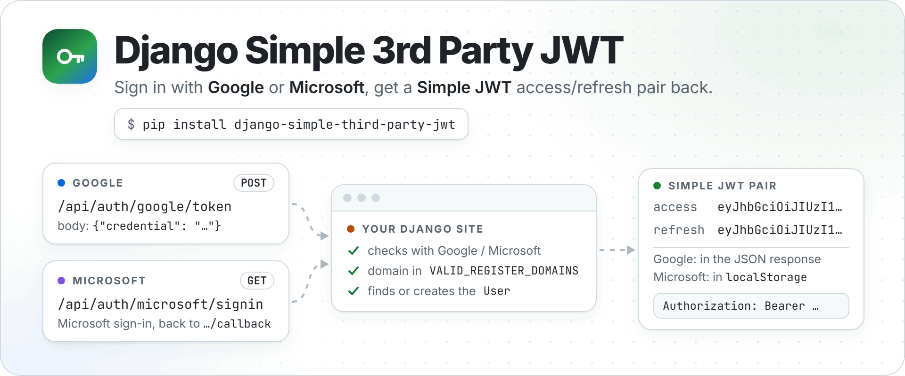

<p align="center">
  <picture>
    <source media="(prefers-color-scheme: dark)" srcset="https://raw.githubusercontent.com/NatLee/django-simple-3rd-party-jwt/main/docs/images/hero-dark.png">
    
  </picture>
</p>

<p align="center">
  <a href="https://github.com/NatLee/django-simple-3rd-party-jwt/actions/workflows/test.yml"></a>
  <a href="https://pypi.org/project/django-simple-third-party-jwt/"></a>
  <a href="https://pypi.org/project/django-simple-third-party-jwt/"></a>
  <a href="https://pypi.org/project/django-simple-third-party-jwt/"></a>
  <a href="https://github.com/NatLee/django-simple-3rd-party-jwt/blob/main/LICENSE"></a>
</p>

Let people sign in to your Django site with **Google** or **Microsoft** and hand your
frontend a **JWT** it can send to your API. Add one app and a few settings and you get
login endpoints that check the provider's answer, keep only the e-mail domains you
allow, create the Django user on first login and answer with a
[Simple JWT](https://github.com/jazzband/djangorestframework-simplejwt) access/refresh pair.
No passwords to store, no OAuth plumbing to write.

- **Google**: your page shows Google's sign-in button, then POSTs the credential to `/api/auth/google/token`.
- **Microsoft**: a link to `/api/auth/microsoft/signin`; the user comes back with the tokens in `localStorage`.
- **Your API**: accepts `Authorization: Bearer <access token>` like any Simple JWT project.

## How it works

<p align="center">
  <picture>
    <source media="(prefers-color-scheme: dark)" srcset="https://raw.githubusercontent.com/NatLee/django-simple-3rd-party-jwt/main/docs/images/login-flow-dark.png">
    
  </picture>
</p>

- **Google** happens in the page: Google's popup hands the browser an ID token (the
  `credential`), the page POSTs it to `/api/auth/google/token`, and your site checks it
  with Google's public keys and your client ID before answering with JSON.
- **Microsoft** happens in redirects: `/api/auth/microsoft/signin` sends the browser to
  Microsoft, Microsoft sends it back to `/api/auth/microsoft/callback` with a code, and your
  site swaps that code for Microsoft tokens (with your client ID and secret). The callback
  answers with a small page that saves the JWTs in `localStorage` and goes on to `LOGIN_REDIRECT_URL`.
- **Both** let in only e-mail domains listed in `VALID_REGISTER_DOMAINS`, find or create
  the Django user, and hand out a Simple JWT access/refresh pair.

Each Google or Microsoft account is linked to a Django user through a small
`SocialAccount` table (`social_account` in the database, also in the Django admin),
so a returning user gets the same account.

## Install

```bash
pip install django-simple-third-party-jwt
```

This also installs Django REST framework, Simple JWT, `google-auth` and `msal`
(Microsoft's auth library). See [supported versions](#supported-versions).

## Quick start

These steps take a Django project to a login page where both buttons work, on
`http://localhost:8000`. Only need one provider? Skip the other one's parts.

<p align="center">
  <picture>
    <source media="(prefers-color-scheme: dark)" srcset="https://raw.githubusercontent.com/NatLee/django-simple-3rd-party-jwt/main/docs/images/setup-map-dark.png">
    
  </picture>
</p>

### 1. Register your site with Google and Microsoft

The buttons only work with credentials of your own. For local testing you need:

- **Google**: an OAuth client ID of type *Web application*, with `http://localhost` and
  `http://localhost:8000` as *Authorized JavaScript origins*.
- **Microsoft**: an Azure app registration with the redirect URI
  `http://localhost:8000/api/auth/microsoft/callback` (platform *Web*), and a client secret.

Click-by-click instructions are in [Getting credentials](#getting-credentials). The `api` in
the redirect URI is the `JWT_3RD_PREFIX` from the next step; the two have to agree.

### 2. Settings

In `settings.py`, add the app, choose the URL prefix and let your API accept the JWT:

```python
INSTALLED_APPS = [
    # ... Django's defaults, including "django.contrib.sessions"
    "rest_framework",
    "django_simple_third_party_jwt",
]

# The login routes live under /<JWT_3RD_PREFIX>/auth/... (required).
JWT_3RD_PREFIX = "api"

# Only these e-mail domains can sign in.
VALID_REGISTER_DOMAINS = ["gmail.com", "outlook.com", "hotmail.com", "live.com"]

# Let your own API views accept the JWT.
REST_FRAMEWORK = {
    "DEFAULT_AUTHENTICATION_CLASSES": [
        "rest_framework_simplejwt.authentication.JWTAuthentication",
        "rest_framework.authentication.SessionAuthentication",
    ],
}
```

For Google, add:

```python
SOCIAL_GOOGLE_CLIENT_ID = "<your-client-id>.apps.googleusercontent.com"

# Let Google's sign-in popup talk back to your page, and send the referrer
# when testing on http://localhost (see Google's setup guide, linked below).
SECURE_CROSS_ORIGIN_OPENER_POLICY = "same-origin-allow-popups"
SECURE_REFERRER_POLICY = "no-referrer-when-downgrade"
```

For Microsoft, add the following, and keep the secret out of your code:

```python
import os

SOCIAL_MICROSOFT_CLIENT_ID = "<your-application-client-id>"
SOCIAL_MICROSOFT_CLIENT_SECRET = os.environ["SOCIAL_MICROSOFT_CLIENT_SECRET"]

# Where the browser goes after a Microsoft login: the page from step 4.
LOGIN_REDIRECT_URL = "/login/"
```

```bash
export SOCIAL_MICROSOFT_CLIENT_SECRET="<your-client-secret-value>"   # before runserver
```

Left one provider out? The app logs a start-up warning about that provider's demo
credentials, which you can ignore as long as you don't link to its routes.

### 3. URLs

In your project's `urls.py`, include the app **at the root**. The `api/` part comes
from `JWT_3RD_PREFIX`, so don't put it in `path()` as well (that gives `/api/api/auth/...`).
The Simple JWT views let the frontend refresh and check tokens, and the last line serves
the login page from step 4.

```python
from django.urls import include, path
from django.views.generic import TemplateView
from rest_framework_simplejwt.views import TokenObtainPairView, TokenRefreshView, TokenVerifyView

urlpatterns = [
    # ...
    path("", include("django_simple_third_party_jwt.urls")),
    path("api/auth/token", TokenObtainPairView.as_view(), name="token_get"),  # optional: username/password login
    path("api/auth/token/refresh", TokenRefreshView.as_view(), name="token_refresh"),
    path("api/auth/token/verify", TokenVerifyView.as_view(), name="token_verify"),
    path("login/", TemplateView.as_view(template_name="login.html"), name="login"),
]
```

That gives you these routes:

| Route | Name | What it does |
|---|---|---|
| `POST /api/auth/google/token` | `google-token` | Google credential in, JWT pair out |
| `POST /api/auth/google/token/session` | `google-token-session` | Same, and also logs the user into the Django session |
| `GET /api/auth/microsoft/signin` | `microsoft-signin` | Sends the browser to Microsoft's sign-in page |
| `GET /api/auth/microsoft/callback` | `microsoft-callback` | Microsoft sends the browser back here; logs in and hands over the JWTs |
| `GET /api/auth/microsoft/signout` | `microsoft-signout` | Forgets the Microsoft token cache, then goes to sign-in |

### 4. Login page

A plain HTML page is enough. Save it as `templates/login.html` next to `manage.py`, and
tell Django to look in that folder: in `settings.py`, set `"DIRS": [BASE_DIR / "templates"]`
in `TEMPLATES`. Google's script turns the `g_id_onload` div into a sign-in button and
calls your function with the credential:

```html
<!doctype html>
<title>Sign in</title>
<script src="https://accounts.google.com/gsi/client" async></script>

<div id="g_id_onload"
     data-client_id="<your-client-id>.apps.googleusercontent.com"
     data-callback="onGoogleCredential"></div>
<div class="g_id_signin" data-type="standard"></div>

<p><a href="/api/auth/microsoft/signin">Sign in with Microsoft</a></p>
<p id="status"></p>

<script>
  async function onGoogleCredential({ credential }) {
    const response = await fetch("/api/auth/google/token", {  // or .../token/session
      method: "POST",
      headers: { "Content-Type": "application/json" },
      body: JSON.stringify({ credential }),
    });
    if (!response.ok) {
      console.error("Login refused:", response.status, await response.json());
      return;
    }
    const { access, refresh } = await response.json();
    // The same keys the Microsoft callback page uses by default.
    localStorage.setItem("access_token", access);
    localStorage.setItem("refresh_token", refresh);
    showStatus();
  }

  // Later, call your API with the token:
  function callApi(url) {
    return fetch(url, {
      headers: { Authorization: `Bearer ${localStorage.getItem("access_token")}` },
    });
  }

  // Microsoft comes back to this page (LOGIN_REDIRECT_URL) with the tokens already stored.
  function showStatus() {
    const token = localStorage.getItem("access_token");
    document.getElementById("status").textContent =
      token ? "Signed in. Access token: " + token.slice(0, 24) + "…" : "Not signed in yet.";
  }
  showStatus();
</script>
```

The login endpoints need no CSRF token. In a Django template you can render the client
ID from `settings.SOCIAL_GOOGLE_CLIENT_ID` instead of typing it twice.

### 5. Migrate and run

```bash
python manage.py migrate
python manage.py runserver
```

Run the full `migrate`: the app's own table *and* Django's session table are needed.

Then open <http://localhost:8000/login/>. Use `localhost`, not `127.0.0.1`: Google only
accepts the origins you registered, and the Microsoft redirect URI is built from the
address in your browser.

### 6. Check that it works

Sign in with either button. The page then says `Signed in. Access token: eyJhbGciOi…`
(with Microsoft, after a short "Welcome!" page). To check a token by hand, copy it from
the browser's `localStorage` (developer tools → Application) and ask Simple JWT:

```bash
curl -i -X POST http://localhost:8000/api/auth/token/verify -d "token=<access token>"
```

`200` with `{}` means the token is valid; anything else answers `401` with
`"code": "token_not_valid"`.

Your own views see the signed-in user once the request carries the token. For example,
in a `views.py` next to `urls.py`:

```python
from rest_framework.decorators import api_view, permission_classes
from rest_framework.permissions import IsAuthenticated
from rest_framework.response import Response


@api_view(["GET"])
@permission_classes([IsAuthenticated])
def me(request):
    return Response({"username": request.user.username, "email": request.user.email})
```

Add `path("api/me", views.me)` to `urlpatterns` (with `from . import views`), then
`callApi("/api/me")` in the page, or
`curl -H "Authorization: Bearer <access token>" http://localhost:8000/api/me`, answers
with the user. Without the token it is `401`.

What the Google endpoint answers:

| Situation | Status | Body |
|---|---|---|
| Signed in | `200` | `{"access": "...", "refresh": "...", "access_token": "...", "refresh_token": "..."}` (two names for the same pair) |
| No `credential` in the request | `400` | `{"credential": ["This field is required."]}` |
| E-mail domain not in `VALID_REGISTER_DOMAINS` | `401` | `{"status": "error", "detail": "This email is invalid."}` |
| Google does not accept the credential | `500` | `{"status": "error", "detail": "Something went wrong :("}` |

After a Microsoft login, the callback page shows a short "Welcome!" and redirects to
`LOGIN_REDIRECT_URL` after a few seconds, with the tokens already in `localStorage`.
The user is also logged into the Django session.
If the domain is not allowed, it says so in red and stores nothing.

## Troubleshooting

| What you see | What to do |
|---|---|
| `ImproperlyConfigured: … needs JWT_3RD_PREFIX` at start-up | Add `JWT_3RD_PREFIX = "api"` to `settings.py`. |
| Warning `django_simple_third_party_jwt.W001` at start-up | `JWT_3RD_PREFIX` has a `/` at one end. It is ignored, so the routes are at `/api/auth/...`; write `"api"` to silence the warning. Coming from 0.3.2 or earlier? See [Upgrading](#upgrading-from-032-or-earlier). |
| `KeyError: 'SOCIAL_MICROSOFT_CLIENT_SECRET'` at start-up | Export the variable before `runserver`, or leave the Microsoft block out. |
| 404 at `/api/api/auth/...` | You included the app under `path("api/", ...)`. Include it at the root, `path("", ...)`. |
| `no such table: django_session` (or `social_account`), or `NOT NULL constraint failed: auth_user.last_login` | The database is not fully migrated. Run the full `python manage.py migrate`, not just this app. |
| The Google button reports that the origin is not allowed | Add the page's exact origin (scheme, host and port) to the client's *Authorized JavaScript origins*, and open the page at that address. |
| The Google endpoint answers `401` "This email is invalid." | The address's domain is not in `VALID_REGISTER_DOMAINS`. |
| The Google endpoint answers `500` "Something went wrong :(" | Google did not accept the credential, often because `SOCIAL_GOOGLE_CLIENT_ID` is not the client ID in your page. The server log says why. |
| Microsoft shows an `AADSTS50011` redirect URI error | Register exactly the redirect URI the error shows (usually `http://localhost:8000/api/auth/microsoft/callback`), and browse the site at that host. |
| The callback page says "Something went wrong while signing in with Microsoft. Please try again." | The server log has Microsoft's reason. `invalid_client` with `AADSTS7000215` means `SOCIAL_MICROSOFT_CLIENT_SECRET` holds the secret's ID instead of its value, or an expired secret. (Up to 0.3.2 the log only says `'access_token'`.) |
| The callback page says "Sorry, this account is not allowed to sign in here." | The account's domain is not in `VALID_REGISTER_DOMAINS`, or its name is not an e-mail address. |

## Upgrading from 0.3.2 or earlier

Only projects whose `JWT_3RD_PREFIX` starts or ends with a `/` (`"/api"`, `"api/"`,
`"/api/"`) or is `"/"` or `""` are affected. With `JWT_3RD_PREFIX = "api"` nothing changes.

0.3.2 and earlier kept that slash, so the routes and the Microsoft redirect URI ended up at
odd addresses. Now the slash is ignored and an empty prefix means "no prefix":

| `JWT_3RD_PREFIX` | Google token route, 0.3.2 | Now | Microsoft redirect URI, 0.3.2 | Now |
|---|---|---|---|---|
| `"api/"` | `/api//auth/google/token` | `/api/auth/google/token` | `<site>/api//auth/microsoft/callback` | `<site>/api/auth/microsoft/callback` |
| `"/api"` | `/%2Fapi/auth/google/token` | `/api/auth/google/token` | `<site>//api/auth/microsoft/callback` | `<site>/api/auth/microsoft/callback` |
| `""` | `/%2Fauth/google/token` | `/auth/google/token` | `<site>//auth/microsoft/callback` | `<site>/auth/microsoft/callback` |

If yours is one of them:

1. In Azure (*App registrations* → your app → *Authentication*), add the new redirect URI.
   Until you do, Microsoft answers `AADSTS50011` (redirect URI mismatch).
2. If your frontend has the old address typed in (with the `//` or `%2F`), change it.
   Links built with `` or `reverse()` follow by themselves.
3. Google needs nothing: its *Authorized JavaScript origins* contain no path.
4. Optional: drop the slash from the setting. Until then, `manage.py check` shows the
   warning `django_simple_third_party_jwt.W001` with the new addresses.

The Microsoft callback page also has clearer messages now: "Sorry, this account is not
allowed to sign in here." and "Something went wrong while signing in with Microsoft.
Please try again." If your code or tests look for the old wording, update them.

## Settings reference

| Setting | Required | Default | What it does |
|---|---|---|---|
| `JWT_3RD_PREFIX` | **Yes** | none: start-up error | URL prefix for every route: `/<prefix>/auth/...`, e.g. `"api"`. A `/` at either end is ignored (`"/api/"` means `"api"`), and `""` puts the routes at `/auth/...`. Also part of the Microsoft redirect URI. |
| `SOCIAL_GOOGLE_CLIENT_ID` | For Google | a shared demo client, with a warning | Your Google OAuth client ID. |
| `SOCIAL_MICROSOFT_CLIENT_ID` | For Microsoft | a shared demo app, with a warning | The *Application (client) ID* of your Azure app. |
| `SOCIAL_MICROSOFT_CLIENT_SECRET` | For Microsoft | a shared demo app, with a warning | A client secret *value* of that app. Load it from the environment. |
| `VALID_REGISTER_DOMAINS` | No | `["gmail.com", "outlook.com", "hotmail.com", "live.com"]` | Only addresses on these domains can sign in, new and returning users alike. Google: the token's `email`. Microsoft: `preferred_username`. |
| `LOGIN_REDIRECT_URL` | No | Django's default, `/accounts/profile/` | Where the Microsoft callback page sends the browser. |
| `MICROSOFT_JWT_REDIRECT_ACCESS_TOKEN_KEY` | No | `"access_token"` | `localStorage` key the Microsoft callback page stores the access token under. |
| `MICROSOFT_JWT_REDIRECT_REFRESH_TOKEN_KEY` | No | `"refresh_token"` | Same, for the refresh token. |

Good to know:

- The app reads these settings once, at start-up. Changing them at runtime (for example
  with `override_settings` in your tests) does not reach it.
- Don't ship with the demo credentials. They belong to the package author, are public,
  and are meant for trying things out locally. The app logs a warning at start-up while
  you use them.
- Token lifetimes and signing are Simple JWT's job: set them in
  [`SIMPLE_JWT`](https://django-rest-framework-simplejwt.readthedocs.io/en/latest/settings.html).
- Frontend on another origin? Add [django-cors-headers](https://github.com/adamchainz/django-cors-headers).
- Behind a reverse proxy, make sure `request.build_absolute_uri()` sees the public scheme
  and host (`SECURE_PROXY_SSL_HEADER`, `USE_X_FORWARDED_HOST`). The Microsoft redirect URI
  is built from it.
- The app links accounts to Django's built-in `User` model.

## Getting credentials

<details>
<summary><b>Google: client ID</b></summary>

1. Open [Google Cloud console → APIs & Services → Credentials](https://console.cloud.google.com/apis/credentials)
   and pick or create a project. If asked, set up the OAuth consent screen first.
2. **Create credentials → OAuth client ID**, application type **Web application**.
3. Under **Authorized JavaScript origins** add every origin that shows the button.
   For local work add both `http://localhost` and `http://localhost:8000`.
4. Create it and copy the **Client ID** (`....apps.googleusercontent.com`) into
   `SOCIAL_GOOGLE_CLIENT_ID`. The client secret is not needed.

More in Google's guide: [Get your Google API client ID](https://developers.google.com/identity/gsi/web/guides/get-google-api-clientid).

</details>

<details>
<summary><b>Microsoft: client ID and secret</b></summary>

1. Open [Azure portal → Microsoft Entra ID → App registrations](https://portal.azure.com/#view/Microsoft_AAD_IAM/ActiveDirectoryMenuBlade/~/RegisteredApps)
   and choose **New registration**.
2. **Supported account types**: *Accounts in any organizational directory and personal
   Microsoft accounts*. The app signs in through the `common` endpoint, which serves both.
3. **Redirect URI**: platform **Web**, value
   `http://localhost:8000/api/auth/microsoft/callback`, i.e.
   `<site root>/<JWT_3RD_PREFIX>/auth/microsoft/callback`. Add your production URL too.
4. On the app's **Overview** page, copy the **Application (client) ID** into
   `SOCIAL_MICROSOFT_CLIENT_ID`.
5. **Certificates & secrets → New client secret**. Copy the **Value** column right away
   (Azure shows it once; the *Secret ID* is something else) and put it in the
   `SOCIAL_MICROSOFT_CLIENT_SECRET` environment variable.
6. **API permissions** already lists Microsoft Graph `User.Read`. That is the only
   permission the app asks for.

</details>

## Example project

[`example/`](https://github.com/NatLee/django-simple-3rd-party-jwt/tree/main/example) is
a small site with a dev dashboard where you can try both logins and see the tokens,
plus Swagger and the admin.

```bash
git clone https://github.com/NatLee/django-simple-3rd-party-jwt
cd django-simple-3rd-party-jwt/example/django_simple_third_party_jwt_example
pip install -r requirements.txt
python manage.py migrate
python manage.py runserver 0.0.0.0:8000
```

Open <http://localhost:8000/api/__hidden_dev_dashboard/>. Other pages:
`/api/__hidden_swagger/`, `/api/__hidden_redoc/` and `/api/__hidden_admin/`
(`python manage.py createsuperuser` first).


The example uses the shared demo credentials unless you export your own:

```bash
export SOCIAL_GOOGLE_CLIENT_ID="<your-client-id>.apps.googleusercontent.com"
export SOCIAL_MICROSOFT_CLIENT_ID="<your-application-client-id>"
export SOCIAL_MICROSOFT_CLIENT_SECRET="<your-client-secret-value>"
```

For a fuller playground, see
[django-simple-3rd-party-jwt-dev-dashboard](https://github.com/NatLee/django-simple-3rd-party-jwt-dev-dashboard),
a reusable dashboard app built on this package.

## Supported versions

Every combination below runs the test suite in CI:

| Django | Python |
|---|---|
| 4.0 | 3.8 – 3.10 |
| 4.1 | 3.8 – 3.11 |
| 4.2 | 3.8 – 3.12 |
| 5.0 | 3.10 – 3.12 |
| 5.1 | 3.10 – 3.13 |
| 5.2 | 3.10 – 3.14 |
| 6.0, 6.1 | 3.12 – 3.14 |

## Development

```bash
git clone https://github.com/NatLee/django-simple-3rd-party-jwt
cd django-simple-3rd-party-jwt
pip install -e . pytest
pytest tests
```

The tests mock Google and Microsoft, so they need no credentials and no network.
To run the same matrix as CI, use [tox](https://tox.wiki/):

```bash
pip install tox
tox run -f py312     # every supported Django version on Python 3.12
tox run -e package   # check-manifest, build the sdist and wheel, twine check
```

`dev-reinstall.sh` (or `dev-reinstall.ps1` on Windows) builds the sdist and installs it,
which is a quick way to check what a release would contain.

Releases are published to PyPI by GitHub Actions when a GitHub release is created.

## License

[MIT](https://github.com/NatLee/django-simple-3rd-party-jwt/blob/main/LICENSE)
